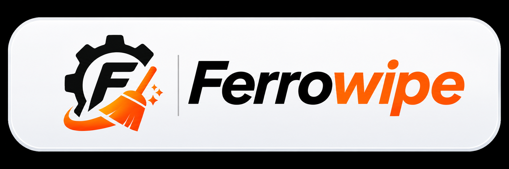
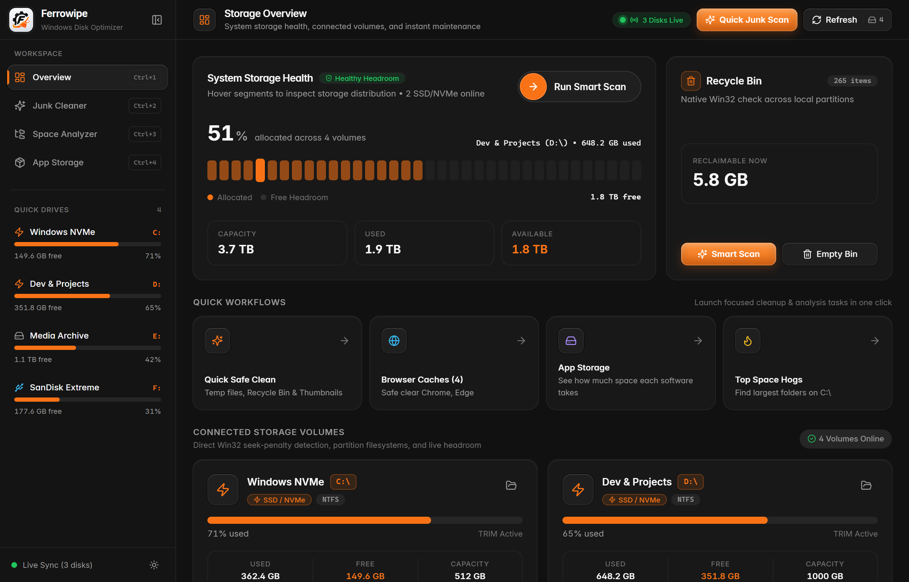
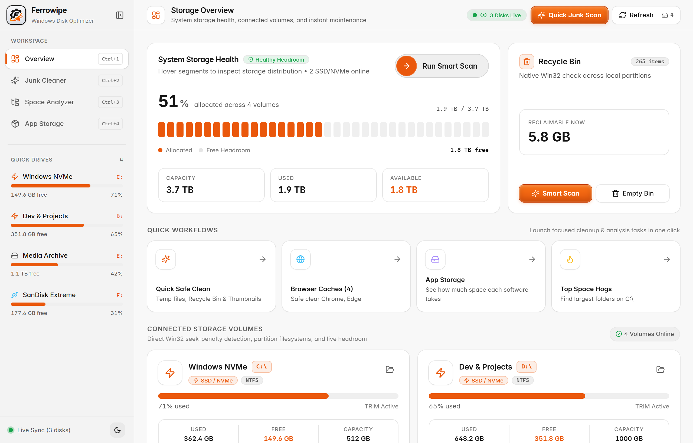
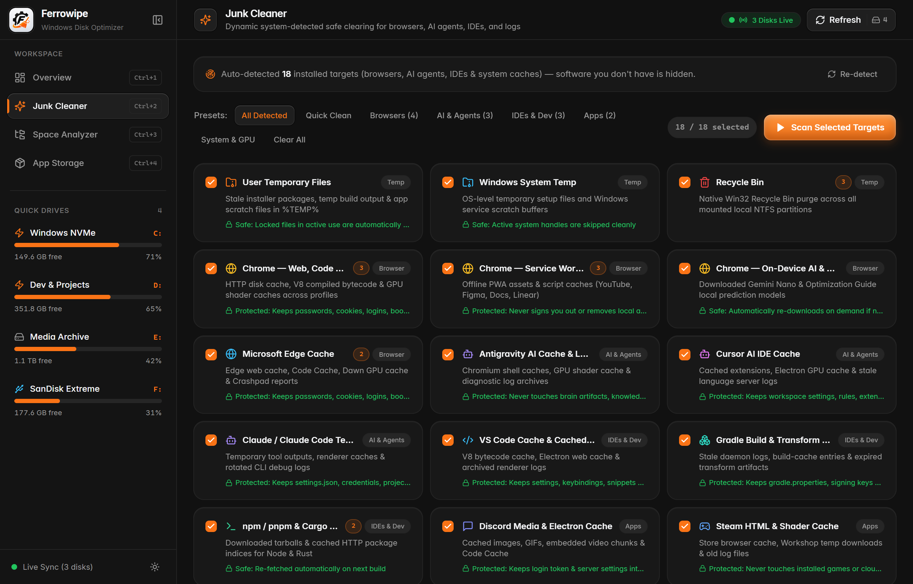
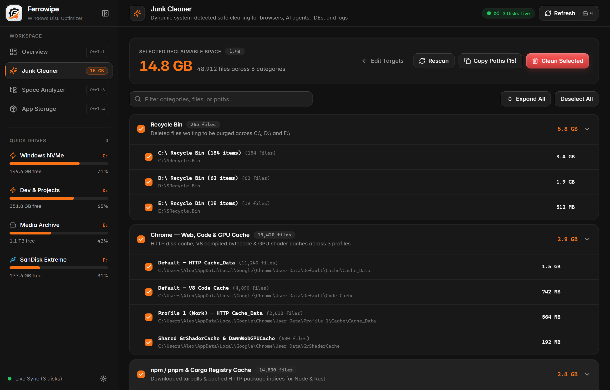
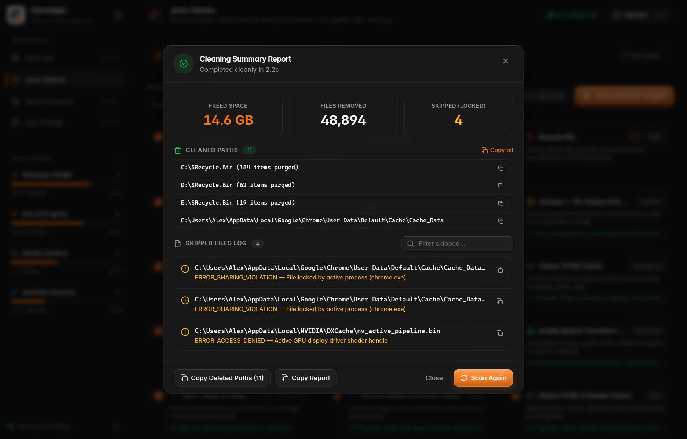
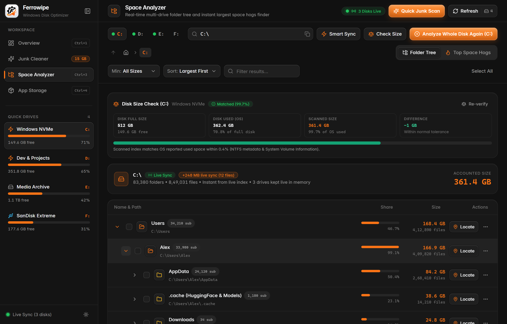
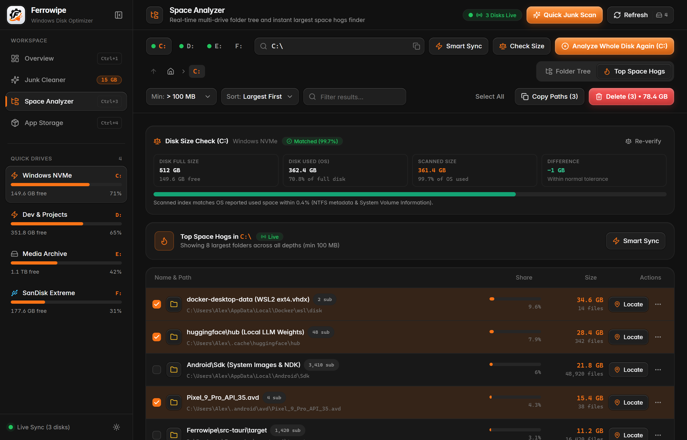
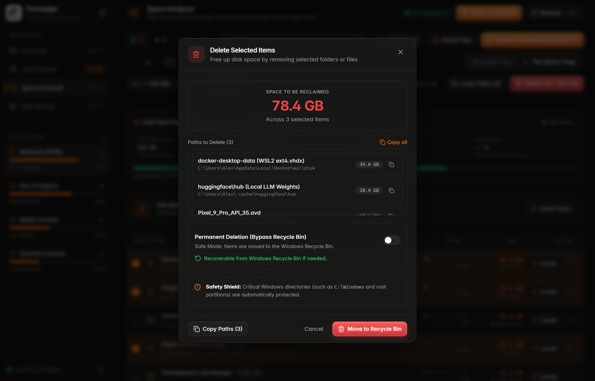
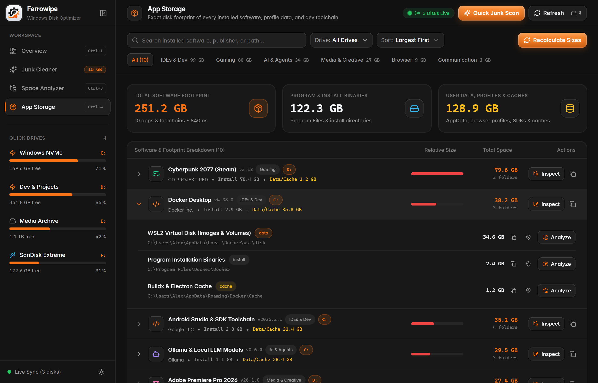

<p align="center">
  
</p>

<h3 align="center">
  Fast, Safe &amp; Modern Windows Disk Optimizer, Junk Cleaner &amp; Space Analyzer
</h3>

<p align="center">
  Reclaim gigabytes of wasted space, see what's filling up your drives in real time, and inspect every app's true disk footprint — in seconds.
</p>

<p align="center">
  <a href="https://github.com/dhruvb2007/Ferrowipe/releases/latest">
    
  </a>
  
  
  <a href="./LICENSE">
    
  </a>
</p>

<p align="center">
  <a href="#-download--install">Download</a> •
  <a href="#-what-ferrowipe-does">Features</a> •
  <a href="#-screenshots">Screenshots</a> •
  <a href="#-built-for-safety--privacy">Safety &amp; Privacy</a> •
  <a href="#-for-developers">Build from Source</a>
</p>

<p align="center">
  
</p>

---

## Why Ferrowipe?

Running out of space on your `C:` drive shouldn't mean installing bloated "PC cleaner" tools packed with ads, popups, or risky registry tweaks.

**Ferrowipe** is a free, open-source Windows desktop app built to do one job exceptionally well: **keep your drives clean and show you exactly where your storage is going.**

* **Instant & Lightweight** — Opens in a blink and uses around ~35 MB of RAM, not hundreds.
* **Safe by Design** — Never touches your personal files, browser passwords, cookies, logins, bookmarks, or Windows system folders.
* **100% Private & Offline** — No accounts, no tracking, no background bloatware, and no ads. Ever.
* **Obsidian Dark & Crisp Light Modes** — Designed with a clean, distraction-free interface that looks right at home on Windows 10 and 11.

---

## ✨ What Ferrowipe Does

### 1. 💽 Storage Overview
Get a clear health check of every drive connected to your PC (`C:`, `D:`, SSD/NVMe, HDD, and external USB drives) the moment you open Ferrowipe.
* **Live Storage Health Bar** — See used space, free headroom, and drive types (`SSD / NVMe`, `HDD`, `NTFS`, `exFAT`) at a glance.
* **Early Low-Space Warnings** — Alerts you automatically when any drive drops below **15%** or **15 GB** free so Windows stays responsive.
* **One-Click Quick Workflows** — Jump straight into *Quick Safe Clean*, *Browser Caches*, *App Storage*, *Top Space Hogs*, or *Empty Recycle Bin*.

---

### 2. 🧹 Smart Junk Cleaner
Ferrowipe automatically detects only the browsers, apps, and tools **actually installed on your PC** — keeping the list clean and relevant.
* **Windows Temp & Recycle Bin** — Clears user temp folders, Windows temp files, thumbnails, crash dumps, Windows Update downloads, and Recycle Bins across all local drives.
* **Browsers (Multi-Profile Safe)** — Cleans web caches, GPU shader caches, and large offline web app caches for **Chrome, Edge, Firefox, Brave, Opera, Opera GX, and Vivaldi** — while **strictly protecting** your passwords, logins, cookies, bookmarks, history, tabs, and extensions.
* **Desktop Apps & GPU Caches** — Safely trims cached media and shaders from **Discord, Spotify, Steam, Slack, Postman, Notion**, plus **DirectX, NVIDIA, and AMD** shader caches.
* **Developer & AI Tooling** — Auto-detects caches and logs from **VS Code, Android Studio, Gradle, JetBrains IDEs, Visual Studio, npm/pnpm/Yarn, pip/uv, Rust Cargo, NuGet, Docker, Cursor, Windsurf, Claude, ChatGPT, Codex, Antigravity, and Ollama** — never touching your projects, SDKs, credentials, or local AI model weights.
* **Full Preview & Detailed Report** — Review every single folder before deleting, see real-time space savings as you check or uncheck items, and get a clean summary report afterward.

---

### 3. 📂 Live Space Analyzer
Stop guessing which hidden folder is eating 80 GB of your SSD.
* **Full-Drive Analysis in Seconds** — Scans an entire drive quickly and keeps sizes synced live in memory as files change on your PC.
* **Interactive Folder Tree & Top Space Hogs** — Expand any folder inline to see exact sizes and file counts, or switch to **Top Space Hogs** to instantly list the biggest space-eaters across your drive.
* **Disk Size Verification** — Cross-checks scanned totals against Windows' reported used space so you know the numbers are accurate.
* **One-Click Locate** — Click **Locate** on any folder to open Windows File Explorer with that exact folder highlighted.
* **Safe Deletion Controls** — Moves deleted items to the **Windows Recycle Bin by default** so you can always recover them, with an explicit toggle if you want permanent deletion.

---

### 4. 📦 App Storage Inspector
Windows' built-in "Installed Apps" list often misses huge hidden folders stored in `AppData`, browser profiles, game caches, and SDKs.
* **True App Footprint** — Separates **Program Install Binaries** from **User Data, Profiles & Caches** so you see the *real* total size of every app.
* **Filter & Search Instantly** — Filter by category (*IDEs & Dev*, *Gaming*, *AI & Agents*, *Media & Creative*, *Browsers*, *Communication*), drive letter, or name.
* **Inspect in One Click** — Jump directly from any app's data folder into the Space Analyzer to see what's inside.

---

## 📸 Screenshots

### Storage Overview — Dark & Light Mode
| Obsidian Dark Mode | Crisp Light Mode |
| :---: | :---: |
|  |  |

### Smart Junk Cleaner — Auto-Detection, Live Preview & Summary Report
| Auto-Detected Cleanup Targets | Interactive Reclaimable Preview |
| :---: | :---: |
|  |  |

<p align="center">
  
  <br />
  <em>Detailed post-clean report showing freed space, removed files, and safely skipped locked files</em>
</p>

### Live Space Analyzer — Folder Tree, Top Space Hogs & Safe Delete
| Interactive Folder Tree & Disk Check | Instant Top Space Hogs |
| :---: | :---: |
|  |  |

<p align="center">
  
  <br />
  <em>Safe Mode moves items to the Windows Recycle Bin by default, backed by Ferrowipe's System Safety Shield</em>
</p>

### App Storage Inspector
<p align="center">
  
  <br />
  <em>See both install binaries and hidden user data/caches for every installed app, game, and toolchain</em>
</p>

---

## ⬇️ Download & Install

1. Go to the **[Ferrowipe Releases Page](https://github.com/dhruvb2007/Ferrowipe/releases/latest)**.
2. Download the version you prefer for **Windows 10 / 11 (64-bit)**:
   * **Windows Installer (`.exe` or `.msi`)** — Recommended for most users. Double-click to install Ferrowipe with a Start Menu shortcut.
   * **Portable (`ferrowipe.exe`)** — Run directly without installing anything.
3. Launch **Ferrowipe** and click **Quick Junk Scan** or **Run Smart Scan**!

> **Note about Windows SmartScreen:** Because Ferrowipe is an independent, free open-source release without a paid commercial code-signing certificate, Windows Defender SmartScreen may show a *"Windows protected your PC"* prompt on first launch. Click **More info → Run anyway** to continue, or build directly from source below.

### ⌨️ Handy Keyboard Shortcuts

| Shortcut | Action |
| :--- | :--- |
| `Ctrl + 1` | Open **Storage Overview** |
| `Ctrl + 2` | Open **Junk Cleaner** |
| `Ctrl + 3` | Open **Space Analyzer** |
| `Ctrl + 4` | Open **App Storage** |
| `Ctrl + B` | Collapse / Expand Sidebar |

---

## 🛡️ Built for Safety & Privacy

* **Hardcoded System Safety Shield** — Ferrowipe blocks deletion of critical Windows directories (`C:\Windows`, root drives, core system paths) at the backend level.
* **Protected Personal & Browser Data** — Hard backend guards ensure passwords, cookies, bookmarks, browsing history, logins, sessions, extensions, app settings, and personal folders are never touched during junk cleaning.
* **Recycle Bin First** — Space Analyzer deletions go to the Windows Recycle Bin by default so mistakes are recoverable.
* **Graceful Locked-File Handling** — Files currently in use by Windows or open apps are cleanly skipped without errors or crashes.
* **Zero Telemetry** — Everything runs locally on your machine. Ferrowipe never sends your file paths or usage data anywhere.

---

## 🛠️ For Developers

<details>
<summary><strong>⚡ Performance Architecture & Tech Stack</strong></summary>

Ferrowipe pairs a **Rust** native backend with **Tauri 2** and **React + TypeScript + Tailwind CSS** for instant startup and minimal memory overhead:

| Area | Typical Electron / WMI Cleaners | Ferrowipe (Rust + Tauri 2) |
| :--- | :--- | :--- |
| **Drive & SSD/HDD Detection** | Slow WMI queries (1.5–3s) | Direct Win32 `IOCTL_STORAGE_QUERY_PROPERTY` (< 0.1ms) |
| **Disk Indexing & Traversal** | Single-threaded synchronous I/O | Parallel Win32 traversal + live `ReadDirectoryChangesW` sync |
| **Recycle Bin Management** | Manual folder recursion | Native Windows Shell API (`SHQueryRecycleBinW` / `SHEmptyRecycleBinW`) |
| **Memory Footprint** | ~150–400 MB (Chromium runtime) | ~30–50 MB (Windows native WebView2) |

</details>

<details>
<summary><strong>🔧 Build from Source (Windows)</strong></summary>

### Prerequisites
1. **Rust (Stable)**: `rustup default stable-x86_64-pc-windows-msvc`
2. **Visual Studio Build Tools**: C++ desktop development workload
3. **Node.js**: v18+ with `npm`
4. **WebView2**: Pre-installed on Windows 10 & 11

### Run in Development Mode
```powershell
git clone https://github.com/dhruvb2007/Ferrowipe.git
cd Ferrowipe
npm install
npm run tauri dev
```

### Build Production Release (Installers + Portable `.exe`)
```powershell
npm run tauri build
```
Outputs are generated at:
* Portable binary: `src-tauri/target/release/ferrowipe.exe`
* NSIS Setup Installer: `src-tauri/target/release/bundle/nsis/Ferrowipe_1.0.0_x64-setup.exe`
* MSI Installer: `src-tauri/target/release/bundle/msi/Ferrowipe_1.0.0_x64_en-US.msi`

</details>

---

## 👤 Author & License

Created by **Dhruv Prajapati** ([@dhruvb2007](https://github.com/dhruvb2007)).

Ferrowipe is open-source software licensed under the **[MIT License](./LICENSE)**.

<p align="center">
  If Ferrowipe helped free up your drive, consider giving the repository a ⭐ on GitHub!
</p>
